# سند ۰۲ — مدل داده و Data Dictionary

۲۴ جدول در سه گروه: مرجع هویت، یکپارچگی/همگام‌سازی، حاکمیت و ممیزی.

## ۱. نمودار ER (خلاصه)

```mermaid
erDiagram
    tenants ||--o{ system_installations : "نصب‌ها"
    tenants ||--o{ persons : "اشخاص"
    persons ||--o{ person_identifiers : "شناسه‌ها"
    persons ||--o{ person_contacts : "تماس‌ها"
    persons ||--o{ identity_account_links : "حساب SSO"
    persons ||--o{ external_id_mappings : "نگاشت (شخص)"
    tenants ||--o{ organizations : "سازمان‌ها"
    organizations ||--o{ organizations : "parent"
    tenants ||--o{ reference_sets : "مجموعه‌ها"
    reference_sets ||--o{ reference_items : "آیتم‌ها"
    system_installations ||--o{ external_id_mappings : "installation"
    system_installations ||--o{ entity_registry : "authority"
    tenants ||--o{ ownership_policies : "سیاست مالکیت"
    tenants ||--o{ change_requests : "درخواست اصلاح"
    tenants ||--o{ resolution_cases : "پرونده تکرار"
    resolution_cases ||--o| merge_records : "merge_record"
    tenants ||--o{ change_log : "تاریخچه"
    tenants ||--|| tenant_change_counters : "شمارنده seq"
    tenants ||--o{ outbox_events : "رویدادها"
    tenants ||--o{ sync_checkpoints : "نقاط پردازش"
    tenants ||--o{ snapshot_jobs : "Snapshotها"
    tenants ||--o{ idempotency_records : "کلیدهای idempotent"
    tenants ||--o{ audit_logs : "ممیزی"
```

## ۲. Data Dictionary (فیلدهای مهم)

### مرجع هویت

| جدول | فیلدهای مهم | قیود/نکته |
|---|---|---|
| `tenants` | id, code(unique), name, status | ایجاد مشتری، شمارنده و سیاست‌های پیش‌فرض را می‌سازد |
| `persons` | id, tenant_id, given_name, family_name, display_name, status(active/inactive/merged), version, merged_into_id | UNIQUE(tenant_id,id) برای کلیدهای مرکب فرزندان؛ UUID شناسه اصلی |
| `person_identifiers` | person_id, type, issuer, encrypted_value(Fernet), value_hash(HMAC), value_masked, verification_status, active_key | UNIQUE(tenant_id, active_key) → یکتایی فقط در وضعیت فعال و در حوزه نوع+صادرکننده؛ کد ملی یکتایی جهانی ندارد |
| `person_contacts` | person_id, type, value, value_hash, verified_at, source_installation_id | FK مرکب به persons |
| `identity_account_links` | person_id, issuer, subject, account_label, status, active_key, linked_by/at | UNIQUE(tenant_id, issuer, active_key) → یک حساب فعال فقط به یک شخص؛ اتصال هرگز بر اساس ایمیل نیست |
| `organizations` | tenant_id, parent_id, type, code, name, sort_order, version | UNIQUE(tenant_id,type,code)؛ FK مرکب به خود؛ منع چرخه در service |
| `reference_sets` | tenant_id, code(unique), title, owner_installation_id, version | نسخه مجموعه با هر تغییر آیتم +۱ |
| `reference_items` | set_id, parent_id, code, title, sort_order, status, valid_from/to | UNIQUE(tenant_id,set_id,code)؛ حذف فیزیکی ندارد (retire) |
| `entity_registry` | entity_type, authority_installation_id, local_key, title | نگاشت موجودیت‌های تخصصی (درس/پروژه) — مشخصات تخصصی ذخیره نمی‌شود |

### یکپارچگی و همگام‌سازی

| جدول | فیلدهای مهم | نکته |
|---|---|---|
| `system_installations` | tenant_id, system_code, installation_code, mode(local/integrated), owner_scopes, last_seen_at | UNIQUE(tenant_id, installation_code) |
| `external_id_mappings` | installation_id, entity_type, local_id, entity_id, status | UNIQUE(tenant_id, installation_id, entity_type, local_id) — شناسه‌های رسمی رشته ذخیره می‌شوند (حفظ صفر ابتدایی) |
| `tenant_change_counters` | tenant_id(pk), last_seq | تخصیص seq با قلم ردیف (FOR UPDATE) — هم‌راستایی ترتیب شماره و Commit (بند ۹.۵) |
| `change_log` | tenant_id, seq, entity_type, entity_id, entity_version, operation, changed_fields, data, occurred_at | UNIQUE(tenant_id,seq)؛ مبنای cursor؛ فقط داده مجاز مشترک |
| `outbox_events` | id=eventId, event_type, payload(JSONB), status, attempts, next_attempt_at, published_at | ثبت در همان تراکنش داده؛ انتشار حداقل یک‌بار |
| `inbox_events` | id=eventId, consumer, processed_at | خنثی‌سازی تکرار (الگوی Inbox) |
| `snapshot_jobs` | scope, status, boundary_seq, file_path, counts, expires_at | خروجی در فایل materialize می‌شود؛ صفحات از یک مرز می‌خوانند |
| `sync_checkpoints` | installation_id, scope, cursor_seq, acknowledged_at | UNIQUE(tenant_id,installation_id,scope) — مبنای lag |
| `idempotency_records` | tenant_id, key(unique با tenant), request_hash, response_status/body | کلید تکراری با ورودی متفاوت → 409 |
| `reconciliation_jobs` | installation_id, report | تطبیق پایه (گزارش) |

### حاکمیت و ممیزی

| جدول | فیلدهای مهم | نکته |
|---|---|---|
| `ownership_policies` | tenant_id, entity_type, field_group, owner_type(role/service/installation), owner_code, version | UNIQUE(tenant_id,entity_type,field_group)؛ تغییر مالکیت ممیزی کامل دارد |
| `change_requests` | entity_type/id, proposed_changes(JSONB), reason, requested_by, status, decided_by/at, applied_version | مسیر اصلاح برای غیرمالک |
| `resolution_cases` | candidate_ids(JSONB), evidence(JSONB), status, decision | شباهت نام فقط نامزد می‌سازد؛ تصمیم انسانی |
| `merge_records` | source_person_id, target_person_id, decided_by, status(applied/reversed), alias_snapshot | سابقه ادغام و بازگردانی |
| `audit_logs` | actor_*, operation, entity, before/after, ip, correlation_id | فقط-افزودن؛ هیچ مسیر ویرایش/حذف API ندارد |

## ۳. قیود ضروری (بند ۷.۳)

- UNIQUE `(tenant_id, installation_id, entity_type, local_id)` — external_id_mappings ✅
- UNIQUE `(tenant_id, issuer, subject)` برای اتصال فعال حساب — با ستون `active_key` (سازگار PG/SQLite) ✅
- UNIQUE `(tenant_id, set_id, code)` — reference_items ✅
- UNIQUE `(tenant_id, installation_code)` — system_installations ✅
- **کلیدهای مرکب** بین والد/فرزند (`tenant_id, id`) عبور ارجاع بین دو مشتری را منع می‌کنند ✅
- زمان‌ها: `timestamptz` / UTC در API؛ شناسه‌ها و کدهای رسمی: رشته؛ JSONB فقط برای payload/تغییر پیشنهادی ✅
- جست‌وجوی دقیق حساس: مقدار رمز Fernet + شاخص HMAC؛ کلیدها بیرون دیتابیس (متغیر محیطی/مخزن امن) ✅
